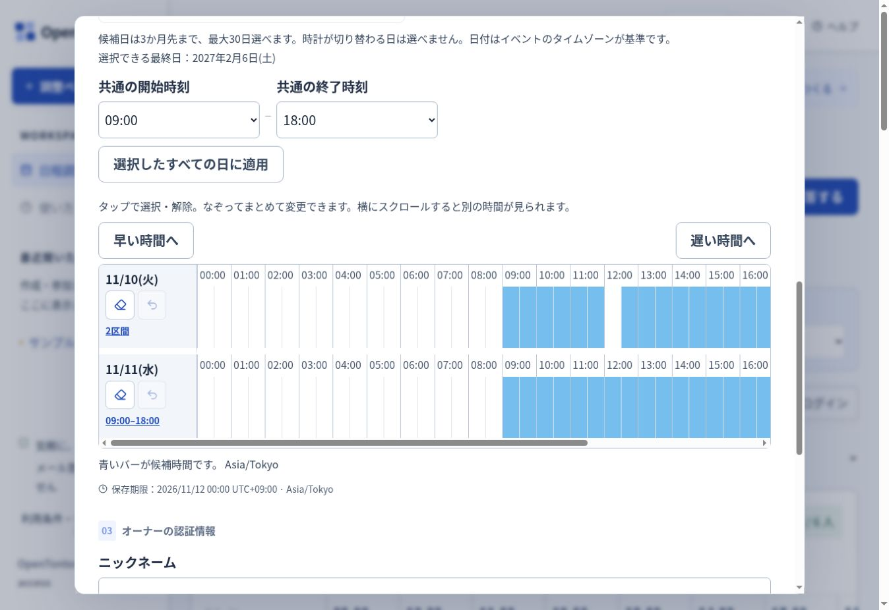

# Time selection UX

Creation, participant registration and answer editing use `SelectionTimeline`.
The 24-hour axis scrolls as one area, keeping dates aligned and pinned on the left.
Each row has a fixed height; fragmented selections are summarized by their range count.
The summary opens an accessible dialog with exact dates, times and UTC offsets.

- Tap or use Space/Enter to toggle a half-hour slot; drag horizontally to paint a range.
- On touch screens, the band reserves horizontal movement for painting. Use the earlier/later controls or swipe the hour labels to scroll time.
- Eraser clears a date. Undo restores up to 20 preceding selections for that date, including bulk application.
- Participant time-zone changes project existing event-slot keys into display times, preserving the selected instants and passwords.
- Calendar selection removes dates. There is no per-date all-day button.
- Submitting creation/registration confirms the displayed terms. Opening terms preserves form entries.

